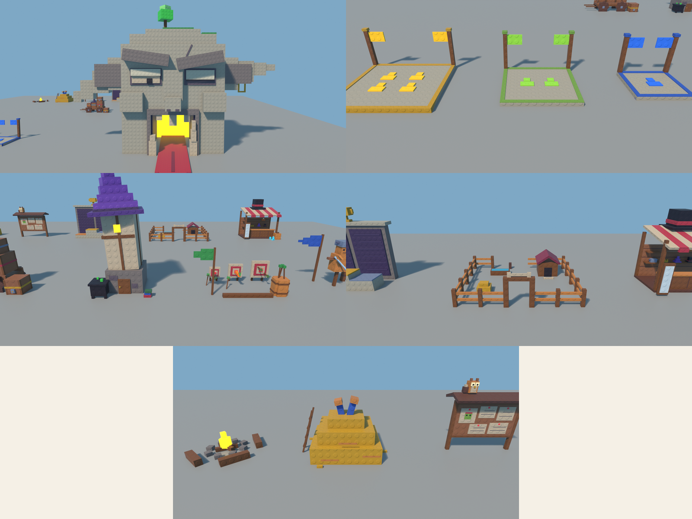

# Kit d'assets « tout en tenons » (A01)

Demande de Clément le 5 nov. 2026 : « Fais-moi juste les modèles, je vais faire la map. » Il place lui-même les assets ; A01 les fabrique.

**Dans COHUE :** `Workspace.A01_AssetKit`, une vitrine posée sur la dalle grise vers (220 à 390, 8, 720 à 830), à l'est du village v1. Chaque asset est un `Model` de Parts :
- pivot au centre de sa base : il se pose directement au sol ;
- surfaces `Studs` sur toutes les faces (on peut repasser Resurface) ;
- couleurs de la palette COHUE 16, `SmoothPlastic` ;
- ancré, sans aucun script.

Pour s'en servir, on déplace l'asset de la vitrine vers la map, ou on le copie (Ctrl+D) pour le garder en modèle.

| Rayon | Assets |
| --- | --- |
| Arbres | Pine_Small, Pine_Medium, Pine_Large, Pine_Tall (long tronc, pour l'arrière-plan), Pine_Wide (bas et touffu), Tree_Round, Tree_Autumn, Bush_Small, Bush_Large |
| Roche | Rock_Small, Rock_Medium, Rock_Large, Cliff_Wall_Long (20 × 14), Cliff_Wall_Short (12 × 9), Cliff_Pillar (6 × 18), Slab_Square, Slab_Long, Slab_Small (pierres de gué ou de chemin) |
| Objets | Mushroom_Red, Mushroom_Group, Bridge_Wood (16 × 5), Fence_Wood (8 de long), Lamp_Post (lanterne Neon et PointLight), Crate, Barrel, Log_Pile, Flower_Patch |
| Muraille | Wall_Stone (12 de long, créneaux), Wall_Pillar (fenêtre Neon) |

Total : 29 assets, 237 Parts.

**Reconstruire :** `A01_AssetKit_build.luau`. On envoie la section `@header` par le MCP de Studio (`execute_luau`, mode Edit), puis `@nature` et `@props`. Les tirages sont fixés (`Random.new(seed)`) : on retrouve exactement le même kit. Le fichier n'est jamais chargé par le jeu.

**Contrôle :** les Parts sont exportées de Studio et rendues dans Blender (`scratchpad/kit/render_kit.py`), parce que les captures de Studio sortaient blanches pendant la session.

## Pièces du lobby

**Dans COHUE :** `Workspace.A01_AssetKit.Lobby`, 14 Models et 496 Parts posés en vitrine vers (205 à 350, 8, 860 à 995). Mêmes règles que le reste du kit (pivot au centre de la base, tenons, palette, sans script), avec l'avant tourné vers −Z.

| Pièce | Ce que c'est | Pour A09 (gameplay) |
| --- | --- | --- |
| Portal_GoblinHead | Tête de gobelin en pierre endormie (28 de large, oreilles comprises 63). La bouche de 12 × 12 est le portail, la langue fait un tapis rouge. | `PortalSwirl` (Neon) : sortie vers la run |
| Pad_Solo, Pad_Friends, Pad_Public | Pads de départ de 8, 11 et 14 de côté. Bleu, vert et jaune, avec 1, 2 et 4 silhouettes et deux mâts à fanions. | Zone `Pad` à lire par GetPartBoundsInBox |
| Station_Knight | Cour d'armes : râtelier d'épées, mannequin d'entraînement, enclume, bouclier, fanion. | attribut `ClassId` = Knight |
| Station_Archer | Pas de tir : trois cibles fléchées, carquois-tonneau, fanions. | `ClassId` = Archer |
| Station_Mage | Tour au toit en chapeau pointu, fenêtre Neon, chaudron. | `ClassId` = Mage |
| Station_LockedClasses | Charrette chargée de cinq caisses cadenassées (classes à débloquer). | |
| Station_GobShop | Échoppe à auvent rayé, chapeau haut-de-forme sur le toit, étagères de chapeaux. | comptoir pour le ShopPrompt |
| Station_CritterPen | Enclos des compagnons : clôture, portail à os, niche, abreuvoir, botte de foin. | portail pour le CrittersPrompt |
| Station_HallOfFame | Panthéon : deux grands panneaux violets, trois socles de statue en gradins et un trophée. | `BoardWeekly`, `BoardAllTime`, `StatueSlot1..3` |
| Station_QuestBoard | Tableau de liège à toit, notes épinglées, affiche « gobelin recherché », hibou facteur. | `Board` pour le SurfaceGui des quêtes |
| Arrival_Haystack | Meule de foin en gradins, deux jambes qui dépassent, échelle. On revient de run en tombant dedans. | point d'apparition (rôle Arrival) |
| Campfire | Feu Neon avec PointLight, cercle de pierres, trois bancs. | |

Chaque Model porte un attribut `Note` qui rappelle son rôle.

**Reconstruire :** `A01_LobbyKit_build.luau`. On envoie d'abord `@header` de `A01_AssetKit_build.luau`, puis `@lobby_header`, `@portal`, `@stations` et `@services`. Chaque section remplace ses propres Models sans toucher au reste.
