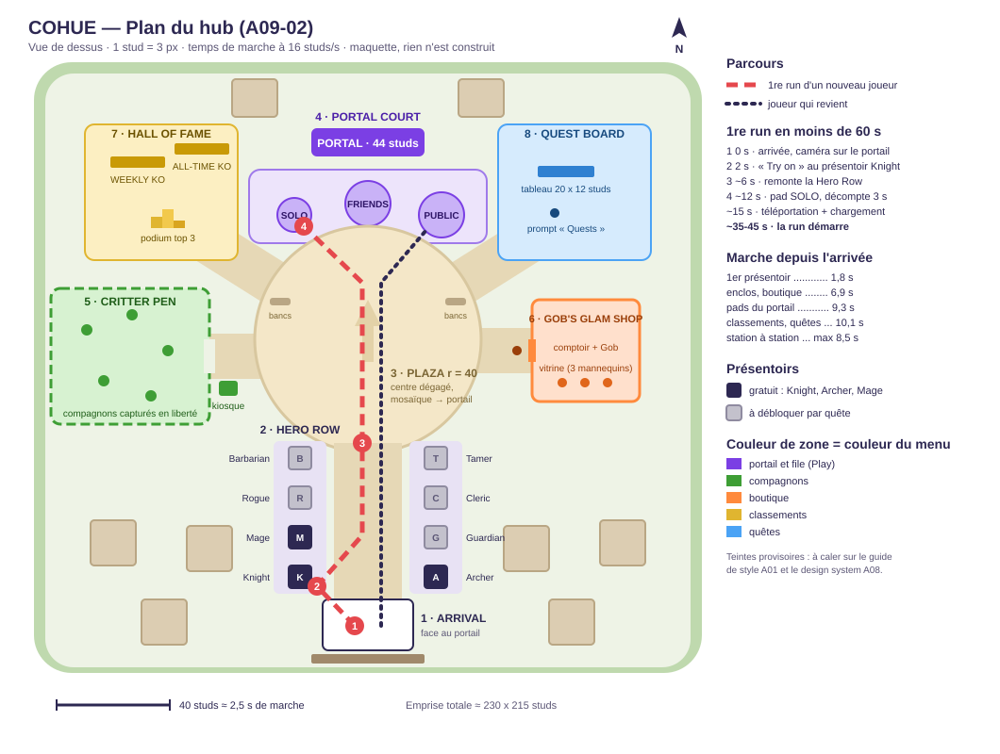

# 65 — Lobby : hub 3D et menus (domaine A09)

Statut : **proposition à valider par Clément** (tâches A09-02 et A09-01). Rien n'est construit en vague 1.
Sources : `01-decisions-v2.md` (fait foi), `00-vision.md` §5.1, §11.3, §12.1, `70-donnees-progression-monetisation.md` §13 et §15, `60-ui-ux.md`.
Schéma : [img/65-lobby-plan.svg](img/65-lobby-plan.svg) (vue de dessus à l'échelle, 1 stud = 3 px).

Le hub est un **petit village voxel compact** : on y arrive face au portail, on passe devant les 8 présentoirs de classes, et on peut lancer sa première run en **environ 40 s** (60 s dans le pire cas). Tout est à moins de 10 s de marche. Chaque station du village a aussi un bouton dans le HUD du hub : sur téléphone, marcher est un plaisir, jamais une obligation.

---

## 1. Brief du monde

| Champ | Valeur |
| --- | --- |
| Nom (jeu) | « the Village » en attendant le nom anglais du jeu. Nom de travail proposé : **Hubbub Village** (« cohue » en anglais) |
| Fantasme | Un village voxel joyeux et un peu absurde, là où les héros se préparent avant d'aller taper la horde |
| Jeu, dans l'ordre | arrivée → choisir une classe → portail → run ; au retour : compagnons, boutique, quêtes, classements |
| Cible | mobile d'abord, 9-15 ans ; **20 joueurs max par serveur de lobby** (proposition), 3 à 8 présents en même temps en général |
| Échelle | R15 par défaut, WalkSpeed 16 (100 studs = 6 s), pas de saut de précision, aucune marche > 1 stud |
| Style | voxel, palette vive (guide de style A01, `80-direction-artistique.md`, en cours) |
| Ambiance | lumière de jour chaude, effet diorama (bloom léger, profondeur de champ douce) : réglage final A02/A07 |
| Héros (repère) | le **Portail** : arche voxel de 44 studs, au nord, vue dès l'arrivée (15° de champ à 160 studs) |
| Quartiers | 8 zones, §3 |
| Chemins | avenue de 24 studs, chemins secondaires de 16 studs, plus clairs et plus lisses que le sol |
| Pas ça | pas de cercles lumineux « reste ici » au sol ; pas de panneaux bavards ; pas de vitrine qui bloque un passage ; pas de pop-up d'achat |
| Budget | ≤ 4 000 instances, ≤ 10 lumières locales dont 2 avec ombre, ≤ 300 k triangles visibles (§8) |

### Les jobs du hub, par priorité

Le vault (« Lobby and Hub Design ») impose de classer ce que le hub doit faire avant de le dessiner. Pour COHUE :

1. **Amener un nouveau joueur à sa première run** : cible ≤ 60 s après la prise de contrôle.
2. **Renvoyer un joueur qui revient en run** : ≤ 20 s, un seul bouton ou un pad.
3. **Montrer la progression** : classements KO, quêtes, classes à débloquer.
4. **Montrer la collection** : compagnons capturés, cosmétiques portés.
5. **Former un groupe** : amis, public, jusqu'à 4.
6. **Proposer la boutique cosmétique**, visible mais jamais sur le passage obligé (public 9-15 ans, §6.6).

---

## 2. Plan et distances

Coordonnées en studs, origine au centre de la place, **nord = −Z** dans Roblox (haut du schéma). Emprise ≈ 230 × 215 studs, fermée par une ceinture d'arbres et de falaises.

| # | Zone (nom en jeu) | Centre (x, z) | Taille | Rôle |
| --- | --- | --- | --- | --- |
| 1 | **Arrival** | (0, 101) | pad 32 × 18 | Apparition, face au portail. Aussi le point de retour après une run |
| 2 | **Hero Row** | avenue x ±12, z 40 → 92 | 8 présentoirs 8 × 8 | Les 8 classes, l'équipement apparaît sur l'avatar |
| 3 | **Plaza** | (0, 0) | rayon 40 | Place centrale vide : on voit le portail à travers |
| 4 | **Portal Court** | (0, −50) | 84 × 26 + arche 40 × 10 | Portail + 3 pads : Solo, Friends, Public |
| 5 | **Critter Pen** | (−84, 6) | 56 × 48, clôturé | Les compagnons capturés s'y promènent |
| 6 | **Gob's Glam Shop** | (77, 4) | bâtiment 38 × 36 | Boutique cosmétique |
| 7 | **Hall of Fame** | (−73, −52) | parcelle 54 × 48 | Classements KO hebdo et all-time, podium |
| 8 | **Quest Board** | (73, −52) | parcelle 54 × 48 | Tableau des quêtes |

### Temps de marche (16 studs/s, en ligne droite sur les chemins)

| Trajet | Distance | Temps | Règle du vault |
| --- | --- | --- | --- |
| Arrivée → 1er présentoir (Knight) | 29 studs | **1,8 s** | 1re station < 15 s ✓ |
| Arrivée → pads du portail | 147-149 studs | **9,3 s** | sortie < 20 s ✓ |
| Arrivée → enclos ou boutique | 110-111 studs | 6,9 s | |
| Arrivée → classements ou quêtes | 161 studs | 10,1 s | |
| Enclos ↔ classements, boutique ↔ quêtes | 51-52 studs | 3,2 s | station → station < 10 s ✓ |
| Enclos ↔ boutique (le plus long) | 110 studs | 6,9 s | ✓ |
| Classements ↔ quêtes | 136 studs | 8,5 s | ✓ |

### Lisibilité sur téléphone

- **Gros repères** : chaque station a une icône voxel flottante de 8 studs à 18-22 studs de haut (patte = enclos, chapeau = boutique, trophée = classements, parchemin « ! » = quêtes, épée = Hero Row). Elles se lisent depuis l'arrivée. Elles tournent lentement, et restent fixes si le joueur a activé la réduction des mouvements.
- **Une couleur par zone, la même que son menu** : quand on ouvre la boutique, le bandeau du menu a la couleur de la boutique du village. Proposition, à caler sur A01 et A08 :

| Zone | Couleur | Menu associé |
| --- | --- | --- |
| Portail et pads | violet (seule zone violette, c'est le héros) | File et groupe (Play) |
| Hero Row | une couleur par classe sur les bannières | Choix de classe |
| Critter Pen | vert feuille | Collection de compagnons |
| Gob's Glam Shop | mandarine | Boutique |
| Hall of Fame | or | Classements |
| Quest Board | bleu ciel | Quêtes |

- La couleur n'est jamais le seul signal : icône + mot sur un panneau de 3 à 8 mots.
- Hauteurs : portail 44 studs, maisons ≤ 22, boutique 20, panneaux 14, bannières de classe 12. Le portail fait au moins 2 fois tout le reste.
- Le centre de la place reste vide : rien ne cache le portail depuis l'arrivée (erreur classique du vault : « sortie derrière la pièce maîtresse »).

---

## 3. Les zones en détail

### 3.1 Arrival

- Pad de 32 × 18 studs, assez pour 4 apparitions simultanées sans chevauchement (12-20 studs par apparition).
- La caméra apparaît derrière le joueur, **tournée vers le portail**. Au premier plan : les présentoirs Knight et Archer.
- Derrière : la porte du village (décor, c'est par là qu'on « revient » d'une run).
- Panneau unique : « PORTAL » avec une flèche.
- Les joueurs qui reviennent d'une run réapparaissent ici, avec leur groupe reformé (§5.3).

### 3.2 Hero Row (8 présentoirs)

Disposition (W = côté ouest, E = côté est, z depuis la place) :

| z | Ouest (x = −24) | Est (x = +24) |
| --- | --- | --- |
| 84 | **Knight** (gratuit) | **Archer** (gratuit) |
| 70 | **Mage** (gratuit) | Guardian (quête) |
| 56 | Rogue (quête) | Cleric (quête) |
| 42 | Barbarian (quête) | Tamer (quête) |

Les 3 classes gratuites sont les plus proches de l'arrivée. Chaque présentoir comprend :

- un socle voxel de 8 × 8 × 2 studs ;
- un mannequin qui porte l'équipement **au palier 3** (ce que la classe devient au niveau 30), dans une pose drôle : le casque du Knight est trop grand, l'Archer vise un pigeon ;
- une bannière verticale de 12 studs à la couleur de la classe, avec son icône ;
- une plaque : nom de la classe + arme de départ (« Knight · Broadsword ») ;
- un `ProximityPrompt` « Try on » sur le mannequin, à hauteur de poitrine : `MaxActivationDistance = 7`, `HoldDuration = 0`, `RequiresLineOfSight = false` (le mannequin cacherait son propre prompt). Les prompts d'un même côté sont à 14 studs (= 2 × 7, règle du vault contre le clignotement entre deux prompts), ceux d'en face à 48.

**Classe débloquée** : « Try on » équipe la classe tout de suite. L'équipement **palier 1** apparaît sur l'avatar avec un petit pop (VFX A07), et un toast dit « Knight equipped! ». Le bouton « Details » du toast ouvre l'écran Choix de classe. Pas de fenêtre bloquante.

**Classe verrouillée** : le mannequin est gris, avec un cadenas voxel et une plaque « Quest: … » (texte de la quête de déblocage). « Try on » montre l'équipement sur l'avatar pendant 8 s, **côté client seulement**, sans aucune stat. Un toast dit « Locked · Quest: Revive 10 teammates » avec un bouton « See quest » qui ouvre l'écran Quêtes sur cette quête. Essayer donne envie, sans jamais rien vendre : les classes ne sont **jamais** en Robux.

### 3.3 Plaza

- Cercle de rayon 40 (le vault conseille 40-70 pour qu'une place paraisse vivante avec 5 joueurs).
- Sol en mosaïque de voxels avec une grande flèche vers le portail.
- Bancs au bord, côté enclos et côté boutique : c'est là qu'on traîne, hors de l'axe arrivée → portail.
- Les emotes et poses de victoire (cosmétiques) se jouent n'importe où ; la place est le « coin photo » naturel, avec le portail en fond.

### 3.4 Portal Court (file solo, amis, public)

- L'**arche du portail** : 40 studs de large, 44 de haut, tourbillon violet (VFX A07 : 2-3 émetteurs, en veille au-delà de 300 studs). Gardée par un **Gland Grincheux** avec un petit drapeau qui « fait signe de passer ».
- Trois pads posés au sol devant l'arche, chacun avec un panneau vertical de 10 studs :

| Pad | Diamètre | Panneau | Fonctionnement |
| --- | --- | --- | --- |
| **Solo** | 12 studs | « SOLO » | Monter dessus → décompte de 3 s affiché sur le pad et à l'écran, bouton « Cancel ». À 0 : téléportation |
| **Friends** | 16 studs | « FRIENDS » | Ouvre l'écran File et groupe sur l'onglet du groupe. Le chef lance : décompte de 5 s pour tout le groupe, où qu'il soit dans le village |
| **Public** | 16 studs | « PUBLIC · 1-4 » | Rejoint la file publique du serveur. Les joueurs présents sur le pad partent ensemble (4 max). Décompte de 10 s dès le 1er joueur, remis à 10 s à chaque arrivée, dans la limite de 20 s au total |

- Détection : boîte interrogée par le serveur (`GetPartBoundsInBox`), **jamais `Touched`** (peu fiable pour un personnage immobile, note du vault).
- Bords dégagés : on descend d'un pad sans traverser personne. Les pads sont à 26 studs les uns des autres.
- État visible sur l'anneau du pad **et** en texte : « Step in! », « Starting in 3 », « 2/4 · Starting in 8 », « Full ».
- Le pad Public lance la run avec les joueurs **de ce serveur de lobby**. Un vrai matchmaking entre serveurs (MemoryStore) viendra après le lancement si les serveurs sont trop vides (question ouverte n° 4).
- Monde de départ : toujours le monde 1 (la run enchaîne les 3 mondes, décision v2 à confirmer).

### 3.5 Critter Pen (enclos des compagnons)

- Prairie clôturée de 56 × 48 studs, porte côté place. Panneau humoristique : « Do not feed the critters. They bite. »
- **Ta collection s'y promène** : jusqu'à 12 de tes compagnons capturés, rendus **côté client** (chacun ne voit que les siens). Ça ne coûte rien au serveur et ça évite 20 joueurs × 30 créatures. Déplacement simple à 10 Hz, en pause si le joueur est à plus de 120 studs.
- Toucher une créature ouvre le prompt « Equip » (portée 6). Le kiosque à la porte ouvre l'écran Collection.
- **Ton compagnon équipé te suit partout dans le village** et les autres le voient : c'est là qu'on montre sa collection et ses cosmétiques (chapeaux, couleurs, auras).
- Le Tamer, qui équipe 2 compagnons, est suivi par les deux.

### 3.6 Gob's Glam Shop (boutique cosmétique)

- Petite boutique voxel tenue par **Gob**, un gobelin qui a quitté la horde : « I used to steal XP. Now I sell hats. »
- Vitrine : 3 mannequins avec les cosmétiques à la une. Ils changent chaque semaine, **sans compte à rebours**.
- Prompt « Shop » sur le comptoir. Aucun prix dans le monde 3D : les prix sont dans le menu, sur chaque article.
- Placée sur le côté de la place, visible depuis l'arrivée, **pas sur le chemin obligé** du portail. Aucune fenêtre ne s'ouvre toute seule.

### 3.7 Hall of Fame (classements KO)

- Deux grands tableaux voxel de 18 × 14 studs, tournés vers la place :
  - **WEEKLY KO** : le plus de KO en une run cette semaine. Ligne fixe « Resets Monday 00:00 UTC » : c'est une information neutre, pas un compte à rebours d'urgence.
  - **ALL-TIME KO** : le record en une run, depuis le lancement.
- Chaque tableau montre le top 10 (`SurfaceGui`, 10 lignes : rang, nom d'affichage, KO, icône de la classe jouée). Rafraîchi toutes les 120 s, comme le serveur (`70-donnees` §13).
- **Podium** devant le tableau hebdo : statues voxel des 3 meilleurs de la semaine (avatars figés), un vrai coin photo. Un 4e socle vide porte la plaque « Your statue here? ».
- Prompt « Leaderboards » : l'écran complet, avec ton rang et le filtre amis.

### 3.8 Quest Board

- Grand tableau de liège voxel de 20 × 12 studs. Un **Hibou Plongeur** perché dessus « livre » les nouvelles quêtes.
- Le tableau affiche **tes** quêtes (rendu client) : les 3 les plus proches de la fin + la prochaine quête de déblocage de classe.
- Prompt « Quests » : l'écran Quêtes.
- Les récompenses sont données automatiquement par le serveur (`70-donnees` §11 : pas de remote de réclamation). L'écran montre « Done! » ; la récompense est déjà dans l'inventaire.

---

## 4. Parcours d'un nouveau joueur : première run en moins de 60 s

Le chrono part quand le joueur prend le contrôle de son personnage. Le vault vise une prise de contrôle ≤ 10 s après l'arrivée sur le jeu : l'écran de chargement couvre ce temps (§6.1).

| t | Ce qui se passe | Ce que voit le joueur |
| --- | --- | --- |
| 0 s | Apparition sur Arrival, caméra tournée vers le portail. **Classe par défaut déjà équipée : Knight.** | Ligne d'objectif en haut au centre : « Pick a class, then jump in the portal! » (8 mots). Une flèche voxel au-dessus du présentoir Knight |
| 2 s | Arrive au Knight (29 studs). « Try on » | L'équipement apparaît sur lui, toast « Knight equipped! » |
| 2-6 s | Peut essayer Archer ou Mage, à 14 et 48 studs | La flèche passe au-dessus du pad **Solo** |
| ~12 s | Monte sur le pad Solo | Décompte 3 s, « Cancel » |
| ~15 s | Téléportation (MatchService : libération du profil, `TeleportAsync` vers un serveur réservé) | Écran de chargement de run (§6.1) avec le nom du monde |
| **~35-45 s** | La run démarre, chrono 10:00 | HUD de run (A08) |

- **Pire cas** : un joueur qui ignore tout et marche droit vers le portail arrive en run vers 30 s, avec le Knight. Un joueur lent ou un téléphone lent (téléportation de 30 s) reste sous 60 s.
- Le pad Solo est mis en avant **pour la 1re run** : c'est le plus rapide et le plus simple pour apprendre. Dès la 2e visite, la flèche disparaît, et le pad Public reçoit un petit badge « Play together! » (la coop compte : objectif 35 % des runs).
- Aucun mur de texte, aucune cinématique, aucun tutoriel bloquant. Les compagnons, la boutique et les quêtes se découvrent au retour.

## 5. Joueurs qui reviennent et flux

### 5.1 Retour (vétéran)

Arrivée → avenue → pad, 9 s ; ou **un seul bouton PLAY** dans le HUD du hub → écran File et groupe → Solo / Friends / Public. Après une run, l'écran de fin (A08) propose déjà « Play again » (rejouer dans la place de run, même équipe) : on ne revient au village que pour changer de classe ou de compagnon, regarder les classements ou faire un tour à la boutique.

### 5.2 Où l'on traîne

Bancs de la place, podium du Hall of Fame, clôture de l'enclos. Tous hors de l'axe arrivée → portail (x = 0) : les nouveaux joueurs n'apparaissent jamais au milieu d'un attroupement.

### 5.3 Groupe

- Groupe de 1 à 4. On invite un joueur du serveur (le toucher → « Invite to party ») ou un ami hors du jeu (invitation Roblox `SocialService:PromptGameInvite`).
- Le chef lance depuis le pad Friends ou l'écran File et groupe. Tout le groupe part, où qu'il soit dans le village.
- Retour de run : le groupe est téléporté ensemble vers le même serveur de lobby et reformé à l'arrivée (demande de contrat data, §10).
- **Pass VIP** : bouton « Private village » dans l'écran File et groupe, pour le propriétaire et ses amis (`MatchService.openVipRoom`, déjà prévu par A12).

### 5.4 Le HUD du hub (raccourcis)

Toutes les stations sont aussi dans le HUD, pour qu'un joueur mobile n'ait jamais à marcher pour une action :

- en haut à gauche : avatar, étoiles d'argent, jetons de quête (les Robux n'apparaissent que sur les boutons de prix) ;
- à droite, colonne de boutons de 56 px : Classes, Critters, Shop, Quests, Ranks, Settings ;
- en bas à droite : gros bouton **PLAY** (la seule action verte de l'écran) ;
- en bas à gauche : joystick.

---

## 6. Les 8 écrans de menu (A09-01)

Maquettes Figma : lien dans la section 11, et dans le Journal du doc de suivi. Règles communes :

- textes en anglais ; lisibles sur un téléphone de 6 pouces (référence 844 × 390) ; **texte ≥ 15 px de maquette** (≥ 12 px à l'écran) ; **zones tactiles ≥ 52 px de maquette** (≥ 44 px à l'écran), écarts ≥ 10 px ;
- dessinés en 1920 × 1080 avec la barre Roblox et l'encoche marquées (couche `skip_safe_area`), puis vérifiés en 844 × 390 ;
- **une seule action verte** par écran, avec un verbe ;
- un bouton verrouillé dit toujours pourquoi ;
- la couleur n'est jamais le seul signal (icône, mot, losanges de rareté) ;
- design system de A08 (glossy cartoon) dès qu'il est publié ; en attendant, wireframes en niveaux de gris.

| # | Écran | Contenu | Action principale |
| --- | --- | --- | --- |
| 1 | **Title & Loading** | Chargement au lancement (logo, barre, astuce) et chargement entre places (nom du monde, membres du groupe qui arrivent) | aucune (pas d'écran « Tap to play » : il coûterait des secondes à la 1re run) |
| 2 | **Class Select** | Avatar 3D qui tourne, 8 classes (3 gratuites, 5 par quête), arme de départ, passif, mouvement, aperçu des paliers 10/20/30 | EQUIP |
| 3 | **Critter Collection** | Grille des compagnons capturés, 1 équipé (2 pour le Tamer), attaque et techniques, onglet Style (chapeaux, couleurs, auras, effets en Robux, aperçu gratuit). **Pas de renommage** | EQUIP |
| 4 | **Shop** | Onglets Hero gear / Critter style / Effects / Emotes / Passes. Prix affiché sur chaque article. Achat via la fenêtre Roblox | le prix (bouton) |
| 5 | **Leaderboards** | Weekly / All-time, Global / Friends, podium top 3, liste, ta ligne fixée en bas | aucune |
| 6 | **Quests** | Classes à débloquer en tête, puis par catégorie, barres de progression, récompense visible | aucune (récompense automatique) |
| 7 | **Settings** | Graphismes, son, contrôles, accessibilité (daltonisme, flashs, taille du texte, garder mon chapeau) | aucune (réglages immédiats) |
| 8 | **Queue & Party** | Solo / Friends / Public, 4 places de groupe, inviter, état prêt, Private village (VIP) | START |

### 6.1 Title & Loading

- **Au lancement** : fond voxel (le village vu du ciel), logo (« COHUE » en attendant le nom anglais), barre de progression, une astuce par chargement (« Stand still in a capture cage for 2 s to catch a critter. »). On passe au village dès que la zone d'arrivée est chargée (`StreamingEnabled`, rayon minimal 64) : on n'attend pas tout le village.
- **Entre places** (village → run, run → village) : carte du monde (« World 1 · Grumpy Woods ») ; vignettes des membres du groupe avec une coche quand ils sont arrivés ; astuce. En cas d'échec de téléportation, message clair (« Couldn't start the run. Try again? ») et retour au village : le profil est repris par MatchService.

### 6.2 Class Select

Écran du présentoir, aussi accessible par le HUD. Liste des 8 classes à gauche (cartes 2 × 4 sur téléphone), avatar au centre (`ViewportFrame` qui tourne, arrêté si mouvement réduit), fiche à droite : arme de départ, passif, mouvement, paliers d'équipement (3 vignettes). Classe verrouillée : cadenas + texte de la quête + barre de progression + « See quest ». Les cosmétiques de classe (skins) se voient dans un sous-onglet « Style », avec le prix de chaque article ; jamais de stat.

### 6.3 Critter Collection

Grille des créatures capturées (vignette, nom de l'espèce, monde d'origine) ; silhouettes grises « Not caught yet » pour donner un objectif de collection, avec l'endroit où on les trouve (« Found in: Grumpy Woods »). Fiche : attaque, cartes de technique. Onglet **Style** : chapeaux, couleurs, auras, effets, aperçu gratuit sur la créature, prix en Robux sur le bouton. Aucun champ de nom (décision v2). Rappel : la capture est gratuite et sûre à 100 %, il n'y a aucun objet payant de capture.

### 6.4 Shop

Règles pour un public de 9 à 15 ans (`00-vision` §11.3, décisions v2 §9) :

- **100 % cosmétique** : aucune stat, aucune classe, aucune résurrection, aucun objet aléatoire payant. Une ligne au bas de l'écran le dit : « Everything here is just for looks. »
- **Prix affiché sur chaque article**, en Robux (icône Robux + nombre) ; l'achat passe par la fenêtre officielle Roblox (`MarketplaceService`), qui confirme.
- **Aperçu gratuit** sur ton avatar ou ton compagnon avant tout achat.
- **Aucune pression** : pas de compte à rebours, pas de « Only 2 left! », pas de rouge d'alerte, pas de pastille « BEST VALUE », pas d'animation qui pulse sur un prix, pas de fenêtre qui s'ouvre toute seule, pas de bouton « No thanks, I don't want to look cool ».
- Les articles gagnés en jouant (jetons de quête, étoiles d'argent) sont dans la même boutique, avec leur prix en jetons : la boutique n'est pas qu'un mur payant.
- Articles déjà possédés : « Owned » + bouton « Equip ».
- Le pass VIP et le pass saisonnier listent clairement leur contenu, 100 % cosmétique (+ serveur privé pour le VIP).

### 6.5 Leaderboards

Onglets **Weekly** / **All-time** et filtre **Global** / **Friends**. Podium des 3 premiers (vignettes d'avatar), puis lignes 4 à 50 : rang, nom d'affichage, KO, classe jouée. **Ta ligne reste fixée en bas** (« You · #1,284 · 2,431 KO »), même hors du top. « Resets Monday 00:00 UTC » en petit, sans alerte. Données : `Leaderboards` (A12), top 50 rafraîchi toutes les 120 s.

### 6.6 Quests

En tête : **Unlock a class** (5 quêtes : Guardian, Rogue, Cleric, Barbarian, Tamer), puis les catégories (Combat, Survival, Critters, Co-op…). Chaque ligne : nom, barre « 34 / 50 », récompense visible (icône + nombre ou nom de l'objet). Une quête terminée affiche « Done! » et une coche ; la récompense est déjà donnée. Pas de quête limitée dans le temps qui crée de l'urgence au lancement.

### 6.7 Settings

Quatre sections à onglets : **Graphics** (qualité Auto / Low / High, effets réduits), **Sound** (musique, effets, curseurs 0-100), **Controls** (sensibilité caméra, sensibilité tactile, position des boutons tactiles), **Accessibility** (Colorblind mode, Reduce flashes, Text size 100/115/130 %, Keep my hat). Chaque ligne entière est tactile. Le jeu est en anglais seul au lancement : pas de choix de langue. Coordination : `SettingsUI` appartient à A08, qui code l'écran ; A09 fournit la maquette du menu.

### 6.8 Queue & Party

Trois grosses cartes de mode : **Solo** (« Just you »), **Friends** (« Your party, up to 4 »), **Public** (« Team up with anyone »). Panneau groupe : 4 places (toi + 3), vignette, nom, classe choisie, état « Ready » ; « Invite » (amis Roblox) ; « Leave party » ; le chef peut retirer un membre. Bouton vert **START**, avec le motif quand il est grisé (« Waiting for Alex to pick a class »). Ligne « World 1 → 2 → 3 ». Pass VIP : bouton « Private village ».

---

## 7. Mobile et accessibilité

- Toute station est atteignable par le HUD : marcher est optionnel.
- Pas de saut de précision, pas d'escalier de plus de 1 stud par marche, aucun passage plus étroit que 16 studs.
- Prompts sur l'objet, à hauteur de poitrine, jamais sous la zone du bouton Saut quand on se tient devant (à vérifier en vrai sur téléphone).
- Réduction des mouvements : icônes fixes, pas de rotation de l'avatar dans les menus, fondus au lieu de pops.
- Daltonisme : chaque zone = icône + mot + couleur. Test en niveaux de gris (`ColorCorrection.Saturation = −1`) : les chemins et les pads doivent rester lisibles.
- Textes des panneaux : 3 à 8 mots, en anglais, intégrés au décor.

## 8. Performance

| Poste | Budget | Note |
| --- | --- | --- |
| Instances (tout le hub) | ≤ 4 000 | vault : hubs mesurés de 913 à 4 531 ; le hub est la 1re chose chargée sur les téléphones faibles |
| Triangles visibles | ≤ 300 k | bas de la fourchette mobile, pour laisser 20-30 % aux effets et à l'UI |
| Lumières locales | ≤ 10, dont 2 avec ombre (portail, vitrine de la boutique) | |
| Émetteurs de particules | ≤ 12 (portail 3, présentoirs 0 au repos, enclos 2) | en veille au-delà de 300 studs |
| Compagnons de l'enclos | ≤ 12, côté client, 10 Hz | en pause à plus de 120 studs |
| Tableaux de classement | 2 × 10 lignes, rafraîchis toutes les 120 s | la liste complète est dans le menu |
| Streaming | `StreamingEnabled`, min 64, Opportunistic, PauseOutsideLoadedArea | Arrival et Hero Row arrivent en premier |

## 9. Ce qui reste à construire (vague 2, après validation)

A09-04 : place du lobby, blockout gris puis formes, puis décor (méthode `fwjelaa-worldbuilding` : 4 passes, audit, budget). A09-05 : `LoadoutUI` du lobby, pads, file, téléportation (avec MatchService). A09-06 : tableaux 3D. A09-07 : collection et boutique. Rien de tout cela n'est commencé.

## 10. Demandes de contrat (pour la vague 2)

| Domaine | Demande |
| --- | --- |
| lead (ARCHITECTURE) | Ajouter au périmètre A09 : la place du lobby, `client/Controllers/Lobby/*`, `server/Services/LobbyService.luau` (pads, présentoirs, enclos), et les noms de boot correspondants |
| data (A12) | `MatchRequest` : accepter un groupe (liste de membres présents) et un mode `Solo`/`Party`/`Public` ; reformer le groupe au retour de run ; API `getParty(player)` |
| data (A12) | Exposer le texte de la quête de déblocage de chaque classe (`Config.Quests`) pour les plaques des présentoirs |
| classes (A04, propriétaire de l'équipement de classe qui remplace TraitService) | `applyClass(player, classId)` utilisable **dans le lobby** (palier 1) et un aperçu client sans stat pour les classes verrouillées |
| companion (A05) | Mode lobby de `CompanionRenderer` : le compagnon équipé suit son joueur (visible de tous), la collection du joueur se promène dans l'enclos (client seul) |
| ui (A08) | Design system Figma (lien dans le Journal) ; `SettingsUI` suit la maquette n° 7 ; toasts et prompts au style du kit |
| VFX (A07) | Pop d'équipement au « Try on », tourbillon du portail, anneau de décompte des pads |
| monde (A02) | Lumière diorama du hub ; kit de maisons voxel |

## 11. Questions ouvertes pour Clément

1. **Nom du village en jeu** : « Hubbub Village » en attendant le nom du jeu (A12 cherche le nom anglais) ? Les noms anglais des mondes (« Grumpy Woods » pour Bois Grognon) sont des exemples à remplacer.
2. **1re run en Solo mis en avant** (le plus rapide pour apprendre), puis Public mis en avant dès la 2e visite : d'accord ?
3. **20 joueurs par serveur de lobby** : d'accord ?
4. **File publique** : on lance avec les joueurs du même serveur (simple), et le matchmaking entre serveurs vient plus tard si besoin ?
5. **Essai des classes verrouillées** (8 s, sur soi, sans stat) : d'accord ?
6. **Enclos** : chacun ne voit que sa propre collection ; les autres voient seulement le compagnon équipé qui te suit. D'accord ?

## Sources vault

- 33 Level Design / **Lobby and Hub Design** : jobs du hub classés, budgets de temps (1re station < 15 s, sortie < 20 s, station → station < 10 s), place de 40-70 studs, prompts espacés de 2 × la portée, pads interrogés par boîte, pas de cercles au sol, budget d'instances (913-4 531 mesurés).
- skill **fwjelaa-worldbuilding** + `references/budgets.md` : brief, héros ≥ 1,5 × le reste et ≥ 3-5° de champ, chemins 20-34 studs, apparition 12-20 studs par joueur, budgets mobile (300-600 k triangles, 8-12 lumières dont 2-3 avec ombre), streaming.
- 05 UI and UX / **Onboarding and FTUE** et 10 / **First-Time User Experience and Onboarding** : contrôle en ~10 s, 1re action en 10-20 s, objectif de 8 mots maximum, pas de mur de texte.
- 05 UI and UX / **Designing Roblox UI in Figma - Frames, Safe Areas and Tokens** : cadres 1920 × 1080 et 844 × 390, texte ≥ 15 px de maquette, zones tactiles ≥ 52 px, couche `skip_safe_area`.
- 21 / **fwjelaa UI Design System** : une seule action verte par écran, dire pourquoi un bouton est verrouillé.
- 41 Multiplayer Services / **Matchmaking Queues with MemoryStore** : le groupe est un seul ticket ; d'abord se demander s'il faut une file entre serveurs.
